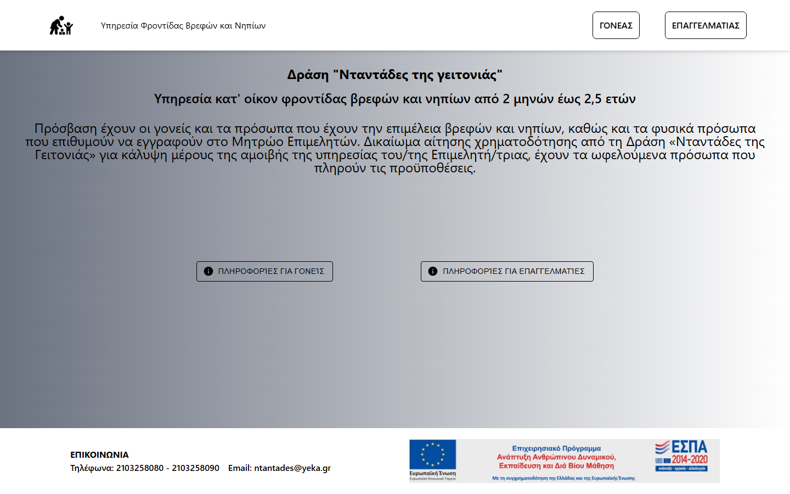

# Neighborhood Nannies: Childcare Services Platform

A responsive web application that connects **parents** with **certified childcare professionals**, modeled on the Greek public programme *"Νταντάδες της γειτονιάς"* (Neighborhood Nannies). It was designed in Figma following a user-centered design process and then implemented with React and Firebase.

🔗 **Live demo:** https://eam-24-25.web.app

> Team project for the *Human-Computer Interaction* course (Dept. of Informatics & Telecommunications, University of Athens, Fall 2024), by Giorgos Fragkakis and Fotios Iasonas Oikonomopoulos.
> This is an academic prototype and **not** an official government service.



## Features

**For parents**
- Sign up / log in (Firebase Authentication)
- Search professionals by area, specialization (e.g. first aid, childcare certification), years of experience and employment type
- View professional profiles and reviews
- Submit and track applications of interest, view appointment history and collaborations
- Payments flow (simulated)

**For professionals**
- Create, edit and manage job listings
- Edit a CV/bio profile
- Receive and handle incoming requests, manage appointments
- View reviews and payment history

**General**
- Protected routes based on authentication state
- Consistent navigation (navbar, footer, back buttons) following HCI guidelines such as consistency, feedback and error prevention
- Deployed on **Firebase Hosting** with SPA rewrites

## Tech stack

| Layer | Tools |
|---|---|
| Frontend | React 18, React Router 7, Vite |
| UI | Material UI (MUI), Tailwind CSS, styled-components, Font Awesome |
| Backend-as-a-service | Firebase Authentication, Cloud Firestore |
| Hosting | Firebase Hosting |
| Design | Figma (wireframes and high-fidelity prototype) |

## Project structure

```
vite-project/
  src/
    routes/       25 pages: g_* = parent pages, e_* = professional pages, shared profile/payments pages
    components/   navbar, footer, ProtectedRoute, back buttons
    config/       Firebase initialization (Auth + Firestore)
  firebase.json   hosting config (SPA rewrites)
```

## Running locally

```bash
cd vite-project
npm install
npm run dev        # http://localhost:5173
```

To deploy: `npm run build && firebase deploy`.

## Authors

- **Giorgos Fragkakis** · [GitHub](https://github.com/fragk17)
- **Fotios Iasonas Oikonomopoulos** · [GitHub](https://github.com/sdi2100125)
